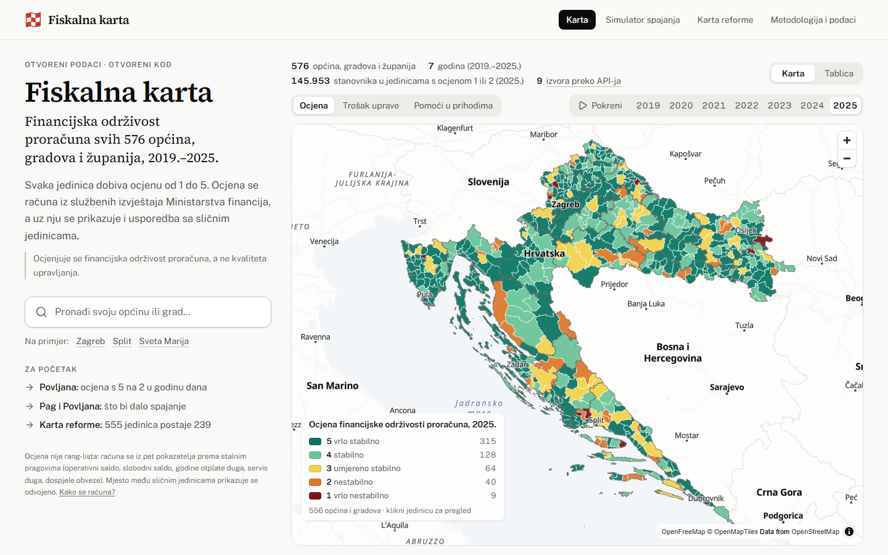

# Fiskalna karta JLS

**Kako stoje financije tvoje općine?** Fiskalna karta daje ocjenu financijske održivosti proračuna od 1 do 5 za svih 576 općina, gradova i županija. Ocjena se računa iz službenih financijskih izvještaja i uspoređuje sa sličnim jedinicama. Metoda, kod i podaci su otvoreni.

> Ocjenjuje se financijska održivost proračuna, a ne kvaliteta upravljanja.

Projekt za [Datathon Portala otvorenih podataka 2026](https://data.gov.hr/-datathon_portala_otvorenih_podataka2026), izazov C: Gospodarstvo i učinkovito upravljanje.

*English: a fiscal sustainability grade (1-5) for all 576 Croatian local and regional governments, built from Ministry of Finance statements and open data, with peer comparison, number-checked AI explanations and an open static API.*

**Stranica:** https://abi-azan.github.io/Datathon-Portala-otvorenih-podataka-2026/

**Tehnička i projektna dokumentacija:** [docs/DOKUMENTACIJA.pdf](docs/DOKUMENTACIJA.pdf) (10 stranica, poredano po kriterijima ocjenjivanja; isti tekst je u [docs/DOKUMENTACIJA.md](docs/DOKUMENTACIJA.md)). Popis svih skupova podataka: [docs/skupovi-podataka.md](docs/skupovi-podataka.md).



## Što radi

- **Karta** svih 556 općina i gradova obojena po ocjeni, za 2019.-2025. Pretraga radi i bez dijakritika, a tablica je alternativa karti.
- **Pregled jedinice:** ocjena i bodovi 0-100, pet pokazatelja uz medijan sličnih jedinica, kretanje kroz sedam godina, upozorenja i stabilnost ocjene u četiri skupa pondera.
- **Kratko objašnjenje s provjerom brojki**, koje piše otvoreni model Gemma 4 31B (vidi [dolje](#kako-nastaje-objašnjenje-gemma-4)).
- **Prikaži izračun:** uz svaki pokazatelj formula i ulazni iznosi s kontom, listom i retkom u datotekama Ministarstva financija. Test iz tih ulaza ponovno dobiva sve objavljene pokazatelje za 576 jedinica.
- **Simulator spajanja** (`#/simulator`): 2-4 susjedne općine ili grada iste županije. Pokazuje ocjenu spojene jedinice, raspon uštede na općoj upravi i promjenu fiskalnog izravnanja po zakonskoj formuli. Svih 13.353 dopuštenih skupina izračunato je unaprijed.
- **Karta reforme** (`#/reforma`): unutar županije najmanja jedinica ispod praga spaja se s najmanjim susjedom, za pragove od 2.500, 5.000 i 10.000 stanovnika (555 → 370, 239 ili 147 jedinica). Scenarij, a ne prijedlog granica.
- **Kontekst koji ne ulazi u ocjenu:** kretanje stanovništva (uživo s API-ja DZS-a), dohodak, turizam i građevinske dozvole, fiskalno izravnanje i zadnje mišljenje Državnog ureda za reviziju.
- **Metodologija** (`#/metodologija`) čita formule, pragove, pondere i AI prompt iz koda. **Otvoreni API** i **MCP server** daju iste brojke drugim aplikacijama i AI asistentima.

## Kako nastaje objašnjenje (Gemma 4)

Model ne računa i ne bira što je važno. To radi naš kod, a model samo piše rečenice oko gotovih brojki, koje program zatim provjerava.

1. **Paket činjenica** (`pipeline/facts.py`). Za svaku jedinicu Python složi popis gotovo formatiranih činjenica: ocjena i bodovi, najslabiji pokazatelj s medijanom skupine, jake strane, upozorenja, pravila i kontekst. Ako je i pokazatelj s najmanje bodova jaka strana jedinice (barem 90 bodova i nije lošiji od medijana skupine), paket ne navodi najslabiji pokazatelj, jer ništa ne spušta ocjenu.
2. **Pisanje** (`pipeline/explain.py`). Gemma 4 31B dobiva paket i osam pravila. Mora napisati 3-5 rečenica, brojke prepisati točno i ne računati nove. Tekst mora biti bez ocjenjivanja, savjeta i nagađanja o uzrocima.
3. **Provjera** (`pipeline/verify.py`):
   - svaka brojka u tekstu mora postojati u paketu;
   - navedena ocjena mora biti ovogodišnja ili prošlogodišnja;
   - najslabiji pokazatelj, jake strane i ograničenje ocjene moraju se slagati s paketom;
   - uz najslabiji pokazatelj mora stajati i njegova vrijednost;
   - ako paket nema najslabijeg pokazatelja, tekst ga ne smije navesti;
   - usporedba s medijanom skupine mora zadržati riječ koja nosi predznak (ostaje ili nedostaje, višak ili manjak) kad se razlikuje od riječi uz brojku jedinice;
   - kontekst se ne smije povezati s ocjenom.

   Tekst koji ne prođe vraća se modelu s popisom grešaka, najviše dva puta. Ako ni tada ne prođe, prikazuje se predložak.
4. **Izvođenje na Kaggleu.** Jedna skripta s ugrađenim paketima, promptom i provjerom pokreće se u Kaggle bilježnici, na besplatnom GPU-u (2× T4). Model poslužuje llama.cpp.
   - Batch od 5.11. obradio je svih 576 jedinica za oko 4 h.
   - Iz prvog pokušaja prošlo je 550 tekstova, nakon ponavljanja 561.
   - Preostalih 15 ponovno je generirano 6.11. s određenijom porukom o grešci i svi su prošli.
   - Isti dan dodana je provjera vrijednosti najslabijeg pokazatelja. Dva teksta koja je nisu navodila (Grad Zagreb i Općina Blato) ponovno su generirana.
   - 6.11. navečer svih 576 tekstova pročitano je uz njihove činjenice. Brojke su bile točne u svima, ali 164 teksta nisu bila dobra:
     - 68 jedinica imalo je kao najslabiji naveden pokazatelj koji je ujedno jaka strana (Grad Rovinj: 100 bodova od 100 i rečenica „Ocjenu najviše spušta…”);
     - u 67 tekstova uz brojku medijana nije bilo riječi „ostaje”, iako jedinici „nedostaje” (Grad Knin: „nedostaje 18,4 %, uz medijan skupine od 9,2 %”, a medijanu ostaje 9,2 %);
     - 29 tekstova imalo je rečenicu koja nije hrvatska („uz medijan skupine od nedostaje 1,7 %”).

     Za sve tri vrste dodano je pravilo u provjeri i određena poruka modelu, a prompt je ostao isti. Ti su tekstovi ponovno generirani u tri pokretanja (`kaggle/results/`, v5, v7 i v8; u zadnjem je 10 od 150 tekstova prošlo iz prvog pokušaja, 138 iz drugog i 2 iz trećeg). AI tekst sada ima svih 576 jedinica i svaki prolazi provjeru. Test `tests/test_verify.py` čita svaki prihvaćeni tekst uz njegove činjenice i traži ono što provjera brojki ne vidi (prva ocjena i bodovi, riječ uz ocjenu, predznak, izostavljen ili izmišljen dio).
5. **Objava.** Tekstovi se commitaju (`data/ai/objasnjenja-2025.json`) zajedno sa sha256 paketa iz kojeg su nastali. CI ne poziva model. Pri objavi ponovno provjeri svaki tekst i prikaže ga samo ako se paket nije promijenio; inače prikazuje predložak.
6. **U sučelju** tekst nosi oznaku poput „AI tekst · Gemma 4 31B · 15/15 brojki provjereno” (Povljana), a svaka brojka pokazuje činjenicu iz koje dolazi.

Model je izabran nakon testova na jedinicama koje nije vidio (`docs/research/06-gemma-test.md`). Ponovno generiranje: `python -m pipeline.explain --kaggle-batch`, pa `--import-batch <izlaz>`. Samo tekstovi koji nisu prošli provjeru: `--kaggle-batch --neprovjereni` (ili `--oib <OIB>` za jednu jedinicu), pa `--import-batch <stari izlaz> <novi izlaz>`.

## Podaci

Svi korišteni skupovi s izdavateljem, poveznicom, licencom i načinom pristupa su u **[docs/skupovi-podataka.md](docs/skupovi-podataka.md)**. Glavni izvori:

| Izvor | Izdavatelj | Pristup |
|---|---|---|
| PR-RAS, RAS-funkcijski i Bilanca JLP(R)S 2019.-2025. | Ministarstvo financija | datoteke (uvjetni GET, ETag) |
| Fiskalno izravnanje: odluke 2021.-2025. i tablica za 2027. | Ministarstvo financija | datoteke (uvjetni GET) |
| Popis 2021. i granice gradova i općina (INSPIRE) | DZS, servis DGU/NIPP | **API: OGC WFS** (ETL i provjera uživo) |
| Stanovništvo, migracije, rođeni i umrli, turizam, građevinske dozvole | DZS | **API: PxWeb** (ETL i uživo iz preglednika) |
| Katalog portala; neto dohodak, porezne stope i porezi Porezne uprave | data.gov.hr, Porezna uprava | **API: CKAN** (ETL i uživo iz preglednika) |
| Izvješća o financijskim revizijama, objavljena 2019.-2026. | Državni ured za reviziju | HTML popis i PDF (`pipeline/dur.py`) |
| Upravne jedinice INSPIRE, indeks razvijenosti 2024. | DGU, MRRFEU | jednokratno, `data/reference/jls_master.csv` |

**Svaki izvor koji ima upotrebljiv API čita se izravno preko API-ja:** katalog Portala (CKAN), šest tablica DZS-a (PxWeb) i dva sloja INSPIRE (WFS), ukupno 9 skupova kroz tri servisa. Ta tri servisa stranica pita i uživo iz preglednika:

- **Metodologija i podaci → Podaci** pokazuje što svaki od njih odgovara u tom trenutku: broj skupova u katalogu Portala, zadnju godinu procjene stanovništva i broj jedinica u sloju granica.
- **Pregled jedinice** uživo pita DZS za broj stanovnika, a Portal za broj skupova koje jedinica objavljuje i dan zadnje izmjene. Portal ne šalje CORS zaglavlje, pa ga preglednik zove kao JSONP (`web/src/lib/portal.ts`).

Ako servis ne odgovori, ostaje brojka iz zadnje obrade.

Datoteke ostaju samo tamo gdje API ne postoji:

- **Ministarstvo financija** (13 datoteka: financijski izvještaji, tablice i odluke o fiskalnom izravnanju) i **Državni ured za reviziju** objavljuju samo Excel i PDF na svojim stranicama.
- **Porezna uprava** objavljuje tablice kao datoteke na Portalu. ETL pri svakoj obradi preko `package_show` nađe najnoviju. Jedina tablica koja ima DataStore API (usporedba stopa 2025. i 2026.) u njemu ima 10.198 praznih redaka od 10.754, pa se i ona čita iz datoteke.
- Svaku datoteku ETL preuzima sam, uvjetnim GET-om, i bilježi adresu, vrijeme, ETag i sha256 (`api/v1/izvori.json`). Ništa se ne preuzima ručno.

Podaci Ministarstva financija nisu na portalu i nemaju izričitu licencu. Koriste se prema Zakonu o pravu na pristup informacijama i uz uvjete Otvorene dozvole (Pravilnik NN 67/17, čl. 4.). Obrazloženje je u [docs/skupovi-podataka.md](docs/skupovi-podataka.md).

## Metodologija ukratko

Pet pokazatelja. Svaki se boduje od 0 do 100 između pragova iz prakse KDZ-a (Austrija) i INEKO-a (Slovačka):

| Pokazatelj | Ponder |
|---|---|
| Operativni saldo | 20 |
| Slobodni saldo | 20 |
| Godine otplate duga | 15 |
| Servis duga | 15 |
| Dospjele obveze | 30 |

Ponderirani zbroj daje ocjenu: 5 = vrlo stabilno, 4 = stabilno, 3 = umjereno stabilno, 2 = nestabilno, 1 = vrlo nestabilno. Uz to idu četiri upozorenja i dva pravila za dospjele obveze. Detalji su na stranici Metodologija, u [docs/PLAN.md](docs/PLAN.md) §3 i u `pipeline/methodology.py`.

## Arhitektura


- **Bez poslužitelja i baze.** Sve se izračuna u CI-ju i objavi kao statične datoteke.
  - `pipeline/` je ETL, jedan modul po izvoru i koraku.
  - `web/` je sučelje (React, Vite, Tailwind, MapLibre GL i OpenFreeMap).
  - `fiskalna_mcp/` je MCP server.
- **Interoperabilnost:**
  - stabilni ključevi (OIB, RKP, službena šifra DGU/DZS);
  - OpenAPI 3.1, CSV i JSON;
  - katalog DCAT-AP s kontroliranim rječnicima EU-a;
  - INSPIRE izvori;
  - zapis provenijencije svakog preuzimanja.
- **Povezivanje s postojećim javnim sustavima:**

  | Sustav | Ključ ili standard | Kako se spaja |
  |---|---|---|
  | Portal otvorenih podataka (data.gov.hr, CKAN) | DCAT-AP, CKAN API | Naš katalog `api/v1/dcat.jsonld` opisuje skupove rječnicima EU-a, pa ga katalog koji podržava DCAT-AP može preuzeti bez ručnog unosa. U drugom smjeru čitamo katalog Portala i izdavatelje povezujemo s jedinicama. |
  | Registar proračunskih i izvanproračunskih korisnika (Ministarstvo financija) | RKP | Svaka jedinica nosi broj RKP iz izvještaja MF-a, pa se rezultati spajaju s bilo kojom tablicom MF-a ili FINA-e. |
  | Sustavi koji jedinicu vode po OIB-u (Porezna uprava, revizija, javna nabava) | OIB | OIB je u šifrarniku (`sifrarnik.csv`) i u svakoj datoteci jedinice. |
  | DZS, DGU i Nacionalna infrastruktura prostornih podataka | službena šifra jedinice, INSPIRE | Statistika i granice spajaju se po službenoj peteroznamenkastoj šifri; granice su i u API-ju kao TopoJSON. |
  | Druge aplikacije i analitički alati | OpenAPI 3.1, JSON, CSV | Sve što stranica prikazuje dostupno je kao datoteka bez ključa; opis je u `openapi.json`. |
  | AI asistenti | MCP | Server `fiskalna_mcp` daje iste brojke s poveznicom na izvor. |

- **Pravni preduvjeti:** podaci MF-a koriste se prema ZPPI (vidi Podaci). Kod je pod EUPL-1.2, a rezultati pod CC BY 4.0.
- **Organizacijski preduvjeti:** MF jednom godišnje objavljuje izvještaje jedinica, a CI ih preuzima sam. Održavanje traži jednu osobu koja godišnje pregleda nove podatke i ponovno pokrene AI tekstove. Najviše bi pomoglo da MF te izvještaje objavljuje na data.gov.hr, s licencom i API-jem.
- **Tehnički preduvjeti:** GitHub (repozitorij, Actions i Pages), Python 3.12 i Node.js 22 u CI-ju te besplatni Kaggle GPU, oko 4 h godišnje.

## Pokretanje

```
py -3.12 -m venv .venv && .venv/Scripts/python -m pip install -r requirements.txt
.venv/Scripts/python -m pipeline.build          # preuzimanje i izračun (oko 4 min; treba Node.js)
.venv/Scripts/python -m pipeline.publish        # statični API u web/public/api/v1
.venv/Scripts/python -m pytest -q tests         # testovi
cd web && npm ci && npm run dev                 # web na http://localhost:5173
```

## Otvoreni API

Osnovna adresa je `<stranica>/api/v1/`, bez ključa. Opis je u `openapi.json`.

| Datoteka | Sadržaj |
|---|---|
| `jedinice.json` | sve jedinice, ocjena i bodovi po godini |
| `jedinice/<slug>.json` | pregled jedinice s objašnjenjem i njegovom provjerom |
| `jedinice/<slug>/izvor.json` | formula i ulazni iznosi s listom i retkom u datotekama MF-a |
| `simulator/zup-<id>.json`, `reforma/prag-<N>.json` | simulator spajanja i Karta reforme |
| `rezultati.csv`, `sifrarnik.csv`, `skupine.json` | rezultati, šifrarnik (OIB, RKP, šifra) i medijani skupina |
| `metodologija.json`, `dcat.jsonld`, `izvori.json` | metodologija iz koda, katalog DCAT-AP, zapis preuzimanja |
| `geo/jls.topo.json` | granice jedinica i županija |

## MCP server

`fiskalna_mcp` je [MCP](https://modelcontextprotocol.io) server nad istim API-jem, samo za čitanje. AI asistent koji podržava MCP može odgovarati našim brojkama, uz poveznicu na izvor.
- Alati: `pronadi_jedinicu`, `pregled_jedinice`, `usporedi`, `scenarij_spajanja`, `karta_reforme`, `izvor_brojke`.
- Pokretanje: `.venv/Scripts/python -m fiskalna_mcp`. Postavke klijenta i primjeri su u [docs/mcp.md](docs/mcp.md).

## Daljnji razvoj

- **Podaci MF-a na data.gov.hr.** Tada se cijela karta hrani s portala, preko CKAN API-ja.
- **Godišnje osvježavanje.** Kad MF objavi 2026., isti ETL izračuna novu ocjenu. AI tekstovi se ponovno pišu samo za jedinice čiji se paket promijenio.
- **Proračunski korisnici.** Sada se ocjenjuje proračun same jedinice, bez vrtića i ustanova. Konsolidirana slika bila bi potpunija.
- **Plan i izvršenje.** Proračuni koje jedinice objavljuju na portalu, uz izvršenje iz izvještaja MF-a.
- **Prognozu razvoja testirali smo i odbacili** (`docs/research/13-prediktori-razvoja.md`). Razvoj je vrlo postojan, a model s 36 prediktora ne predviđa rast dohotka bolje od prošlog trenda.

## Licence

- **Kod:** [EUPL-1.2](LICENSE).
- **Podaci koje projekt proizvodi:** [CC BY 4.0](LICENSE-DATA.md), uz navođenje izvornih skupova.
- **Izvorni podaci** ostaju pod svojim uvjetima ([docs/skupovi-podataka.md](docs/skupovi-podataka.md)). OpenStreetMap (ODbL) služi samo kao podloga karte.
- **Softver trećih strana:** [THIRD_PARTY_LICENSES.md](THIRD_PARTY_LICENSES.md). Sve je otvorenog koda, a fontovi su pod SIL OFL 1.1.

## Korišteni AI alati

| Alat | Licenca ili uvjeti | Za što |
|---|---|---|
| Gemma 4 31B-it (QAT Q4_0, GGUF) | Apache-2.0 | u proizvodu: tekst objašnjenja ocjene |
| Gemma 4 E4B, 12B i 26B-A4B | Apache-2.0 | samo testovi pri izboru modela |
| llama.cpp | MIT | izvođenje modela na Kaggle GPU-u |
| Kaggle (bilježnice, Kaggle Models, Kaggle MCP server) | Kaggle Terms of Use | GPU i upravljanje bilježnicama |
| Claude Code | vlasnički alat; prava na izlaze ima korisnik | razvojni alat: pisanje i pregled koda, testovi, provjera brojki i nacrti dokumentacije, prema planu i odlukama tima (`docs/PLAN.md` §11) |
| gstack | MIT | razvojni alat: pregled sučelja u pregledniku |
| Whisper large-v3-turbo (preko faster-whisper, lokalno) | MIT | samo video: vremena izgovorenih riječi za rezove i titlove te provjera izgovorenih brojki; glas u videu je ljudski, a tekst titlova ručno ispravljen |

U aplikaciji se prikazuju samo tekstovi otvorenog modela.
