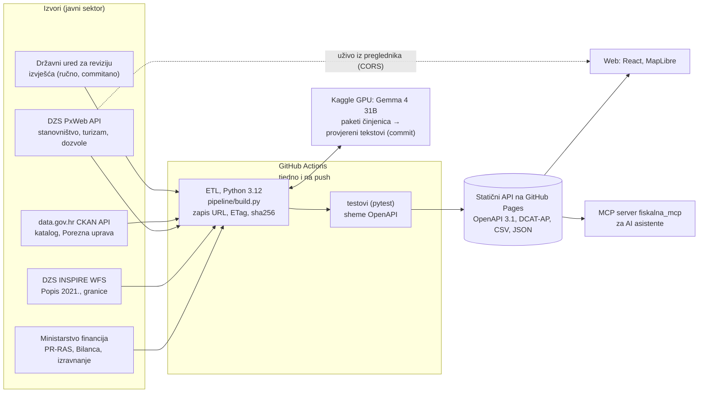

# Fiskalna karta JLS

**Kako stoje financije tvoje općine?** Fiskalna karta daje ocjenu financijske stabilnosti od 1 do 5 za svih 576 općina, gradova i županija. Ocjena se računa iz službenih financijskih izvještaja i uspoređuje sa sličnim jedinicama. Metoda, kod i podaci su otvoreni.

> Ocjenjuje se financijska održivost proračuna, a ne kvaliteta upravljanja.

Projekt za [Datathon Portala otvorenih podataka 2026](https://data.gov.hr/-datathon_portala_otvorenih_podataka2026), izazov C: Gospodarstvo i učinkovito upravljanje.

*English: a fiscal health grade (1-5) for all 576 Croatian local and regional governments, built from Ministry of Finance statements and open data, with peer comparison, verified AI explanations and an open static API.*

**Stranica:** `https://abi-azan.github.io/Datathon-Portala-otvorenih-podataka-2026/` (objava preko GitHub Actions, vidi dolje)


## Što radi

- **Karta** svih 556 općina i gradova obojena po ocjeni, za godine 2019.-2025. Pretraga "Pronađi svoju općinu" radi i bez dijakritika.
- **Pregled jedinice:**
  - ocjena s riječju i bodovi 0-100;
  - mjesto u usporednoj skupini;
  - stabilnost ocjene u četiri scenarija pondera;
  - pet sastavnica uz medijan sličnih jedinica;
  - trend kroz sedam godina;
  - upozorenja i napomene o kvaliteti podataka;
  - kontekst, otvorenost na data.gov.hr i susjedi.
- **Kratko objašnjenje s provjerom brojki.** Python izračuna sve brojke i odabere što je važno. Jezični model (Gemma 4 31B na Kaggleu) samo napiše tekst oko njih. Program zatim provjeri da je svaka brojka u tekstu točna, da je navedena ocjena stvarna i da se najslabija sastavnica, jake strane i ograničenje ocjene slažu s činjenicama. Tekst koji ne prođe provjeru zamjenjuje predložak.
- **Vidljiva provjera brojki.** Svaka brojka u objašnjenju pokazuje činjenicu iz koje dolazi. Ispod svake sastavnice je "Kako je izračunato": formula, pomoćne veličine po godinama i ulazni iznosi s kontom, listom i retkom u datotekama Ministarstva financija. Test iz samih tih ulaza ponovno dobiva objavljene pokazatelje za svih 576 jedinica.
- **Simulator spajanja** (`#/simulator`): odabir 2-4 susjedne općine ili grada iste županije na karti ili pretragom. Prikazuje ocjenu spojene jedinice i rang u skupini, iznose prije i poslije (dospjele obveze, uprava), raspon uštede na općoj upravi i promjenu fiskalnog izravnanja po zakonskoj formuli. Svih 13.353 dopuštenih skupina izračunato je unaprijed.
- **Karta reforme** (`#/reforma`): scenarij u kojem se unutar županije najmanja jedinica ispod praga spaja s najmanjim susjedom, za pragove od 2.500, 5.000 i 10.000 stanovnika (555 → 370, 239 ili 147 jedinica). Scenarij, ne prijedlog granica.
- **Stanovništvo i gospodarstvo** u pregledu jedinice: kretanje broja stanovnika od 2021., prirodni prirast, neto migracija, noćenja turista, građevinske dozvole, neto dohodak i udio mirovina, uz medijan usporedne skupine. Niz stanovništva preglednik traži **uživo s API-ja DZS-a** (PxWeb, oznaka "uživo s API-ja DZS-a"), a spremljena kopija iz builda je rezerva. Ne ulazi u ocjenu.
- **Fiskalno izravnanje** u pregledu jedinice: porezni kapacitet po stanovniku prema referentnoj vrijednosti, procjena godišnje isplate i, za 124 jedinice s nižom stopom poreza na dohodak, procjena koliko bi proračun imao uz najviše stope. Ne ulazi u ocjenu.
- **Revizija Državnog ureda za reviziju** u pregledu jedinice: zadnje mišljenje financijske revizije (bezuvjetno, uvjetno, nepovoljno ili suzdržano), revidirana godina i poveznica na izvješće, ili "nije imala financijsku reviziju od 2019.". Ne ulazi u ocjenu.
- **Metodologija i podaci** (`#/metodologija`): formule, pragovi, ponderi, pravila i AI prompt čitaju se iz koda (`metodologija.json`), uz popis svih skupova podataka.
- **MCP server** (`fiskalna_mcp`): AI asistenti koji podržavaju MCP mogu pitati za ocjenu, usporedbu, scenarij spajanja i izvor brojke, a odgovaraju našim brojkama s poveznicom (vidi dolje).
- **Otvoreni API**: statične datoteke bez ključa, opisane u OpenAPI 3.1. Sadrži sve rezultate, šifrarnik (OIB ↔ RKP ↔ šifra DGU/DZS ↔ naziv), granice, simulator, Kartu reforme, izvor svake brojke i zapis provenijencije svakog preuzimanja.

## Podaci

Svi korišteni skupovi s izdavateljem, poveznicom, licencom i načinom pristupa su u **[docs/skupovi-podataka.md](docs/skupovi-podataka.md)**. Taj se popis generira iz `data/reference/skupovi.csv`. Glavni izvori:

| Izvor | Izdavatelj | Pristup |
|---|---|---|
| PR-RAS, RAS-funkcijski i Bilanca JLP(R)S 2019.-2025. | Ministarstvo financija | datoteke (uvjetni GET, ETag) |
| Popis 2021. i granice gradova i općina (INSPIRE) | DZS, servis DGU/NIPP | **API: OGC WFS** |
| Katalog Portala otvorenih podataka | data.gov.hr | **API: CKAN** |
| Procjene stanovništva, migracije, rođeni i umrli, turizam, građevinske dozvole (6 tablica) | DZS | **API: PxWeb** (u ETL-u, a niz stanovništva i uživo iz preglednika) |
| Gradovi i općine u statistici (stanovništvo 2025., dok ga PxWeb nema) | DZS | datoteka s podaci.dzs.hr, skup na data.gov.hr (uvjetni GET) |
| Neto dohodak po jedinicama, porezne stope, porez na potrošnju i nekretnine, dohodak po razredima | Porezna uprava | datoteke s data.gov.hr, pronađene preko **CKAN API-ja** (`package_show`) |
| Tablice udjela i odluke o fiskalnom izravnanju 2021.-2025. | Ministarstvo financija | datoteke (uvjetni GET) |
| Tablica fiskalnog izravnanja za 2027. (kapacitet, referentne vrijednosti, puni iznosi) | Ministarstvo financija | datoteka (uvjetni GET) |
| Izvješća o financijskim revizijama JLP(R)S, objavljena 2019.-2026. | Državni ured za reviziju | HTML popis i PDF (`pipeline/dur.py`, rezultat u `data/reference/dur_revizije.json`) |
| Upravne jedinice INSPIRE, indeks razvijenosti 2024. | DGU, MRRFEU | jednokratno, u `data/reference/jls_master.csv` |

Podaci Ministarstva financija nisu na Portalu otvorenih podataka i nemaju izričitu licencu. Koriste se prema Zakonu o pravu na pristup informacijama (čl. 27. i 31.) i uz uvjete Otvorene dozvole, koja prema Pravilniku NN 67/17 (čl. 4.) vrijedi kad tijelo nije objavilo druge uvjete. Obrazloženje je u [docs/skupovi-podataka.md](docs/skupovi-podataka.md). Preporuka Ministarstvu: objaviti PR-RAS, RAS-funkcijski i Bilancu na data.gov.hr, s licencom i API-jem.

## Metodologija ukratko

Pet pokazatelja, svaki se boduje 0-100 interpolacijom između pragova iz prakse KDZ-a (Austrija) i INEKO-a (Slovačka):

| Pokazatelj | Ponder |
|---|---|
| Operativni saldo | 20 |
| Slobodni saldo | 20 |
| Godine otplate neto duga | 15 |
| Servis duga | 15 |
| Dospjele neplaćene obveze | 30 |

- Ponderirani zbroj daje ocjenu: 5 = vrlo stabilno, 4 = stabilno, 3 = umjereno, 2 = pod pritiskom, 1 = ozbiljan pritisak.
- Uz to idu četiri crvene zastavice i dva pravila za dospjele obveze.
- Detalji su u [docs/PLAN.md](docs/PLAN.md) §3 i u `pipeline/methodology.py`, uz testove. Odluke i provjere su u `docs/research/`.

## Arhitektura



Moduli ETL-a:

```
IZVORI  MF (XLSX, ETag) · DZS INSPIRE WFS i PxWeb · data.gov.hr CKAN API · Porezna uprava · DUR
   │      pipeline/sources.py zapisuje URL, vrijeme, ETag i sha256 svakog preuzimanja
   ▼
ETL (Python 3.12)       pipeline/build.py
   mf.py → units.py → population.py → geo.py → openness.py → izravnanje_isplate.py → methodology.py
   │                                         (susjedi, otoci, TopoJSON)
   ├─ pxweb.py + dzs_xlsx.py, porezna.py → kontekst.py      (kontekst, ne ulazi u ocjenu)
   ├─ merge.py (+ izravnanje.py) → simulator/zup-XX.json   (13.353 skupine, unaprijed)
   ├─ reforma.py → reforma/prag-N.json                     (pohlepno pravilo, 3 praga)
   ├─ facts.py → explain.py → verify.py ──► Kaggle (Gemma 4 31B, llama.cpp, T4 GPU)
   │                            ◄── data/ai/objasnjenja-2025.json (commitano, sha256 paketa)
   ▼
STATIČNI API            pipeline/publish.py → web/public/api/v1/  (+ openapi.json)
   provenance.py (izvor svake brojke) · metodologija.py (metodologija iz koda)
   ▼
WEB (React, Vite, Tailwind, MapLibre GL + OpenFreeMap)  web/
MCP SERVER (fiskalna_mcp, stdio)  isti statični API za AI asistente, samo čitanje
   ▼
GitHub Actions (.github/workflows/deploy.yml): ETL → API → testovi → build → GitHub Pages
```

- Nema poslužitelja ni baze. Sve se izračuna u CI-ju i objavi kao statične datoteke.
- AI tekstovi generiraju se jednom na Kaggleu i commitaju. CI ih samo provjerava i objavljuje.
- **Interoperabilnost:** stabilni ključevi (OIB, RKP, službena šifra DGU/DZS), OpenAPI 3.1, CSV i JSON, katalog DCAT-AP (EU kontrolirani rječnici za licencu, format, temu, državu i učestalost), INSPIRE izvori i zapis provenijencije.
- **Preduvjeti:**
  - **pravni:** podaci MF-a (PR-RAS, Bilanca, izravnanje) nemaju izričitu licencu, pa se koriste prema ZPPI i Pravilniku NN 67/17 (obrazloženje u `docs/skupovi-podataka.md`); ostali izvori su pod Otvorenom dozvolom ili navedenim uvjetima. Kod je pod EUPL-1.2, a rezultati pod CC BY 4.0;
  - **organizacijski:** MF jednom godišnje objavljuje izvještaje jedinica (konačni podaci za prethodnu godinu, oko srpnja), a tjedni CI ih preuzme sam. Najviše bi pomoglo da MF te izvještaje objavi na data.gov.hr, s licencom i API-jem. Održavanje traži jednu osobu koja godišnje pregleda nove podatke i pokrene AI tekstove;
  - **tehnički:** GitHub (repozitorij, Actions, Pages) bez poslužitelja i baze; Python 3.12 i Node.js 22 (mapshaper) u CI-ju; besplatni Kaggle GPU (oko 4 h godišnje) za AI tekstove. Statični API može preuzeti bilo koja institucija, a katalog DCAT-AP može preuzeti portal.

## Pokretanje

```
py -3.12 -m venv .venv && .venv/Scripts/python -m pip install -r requirements.txt
.venv/Scripts/python -m pipeline.build          # preuzimanje i izračun (oko 4 min; treba Node.js)
.venv/Scripts/python -m pipeline.publish        # statični API u web/public/api/v1
.venv/Scripts/python -m pytest -q tests         # testovi
cd web && npm ci && npm run dev                 # web na http://localhost:5173
```

## Otvoreni API

Osnovna adresa je `<stranica>/api/v1/`, a opis je u `openapi.json`.

| Datoteka | Sadržaj |
|---|---|
| `jedinice.json` | sve jedinice, ocjena i bodovi po godini |
| `jedinice/<slug>.json` | pregled jedne jedinice, s objašnjenjem i oznakom AI ili predložak |
| `jedinice/<slug>/izvor.json` | formula pokazatelja, pomoćne veličine i ulazni iznosi s listom i retkom u datotekama MF-a |
| `simulator/zup-<id>.json` | simulator: svaka skupina od 2-4 susjedne jedinice županije, s uštedom i izravnanjem |
| `reforma/prag-<N>.json` | Karta reforme za prag od 2.500, 5.000 ili 10.000 stanovnika |
| `metodologija.json` | formule, pragovi, ponderi, pravila, AI prompt i opis provjere, iz koda |
| `dcat.jsonld` | katalog skupova u DCAT-AP (JSON-LD), za preuzimanje u portal otvorenih podataka |
| `skupine.json` | medijani usporednih skupina |
| `rezultati.csv` | jedan red po jedinici i godini |
| `sifrarnik.csv` | OIB, RKP, šifra, naziv, vrsta, županija |
| `geo/jls.topo.json` | granice, slojevi jls i zupanije |
| `izvori.json` | zapis svakog preuzimanja |
| `skupovi.json` | popis skupova podataka |

## MCP server

`fiskalna_mcp` je read-only [MCP](https://modelcontextprotocol.io) server nad istim statičnim API-jem. Bilo koji AI asistent koji podržava MCP (Claude Desktop, Claude Code, MCP Inspector…) može odgovarati na pitanja o jedinicama našim brojkama, uz poveznicu na izvor. Server ne računa ništa novo.

- Alati: `pronadi_jedinicu`, `pregled_jedinice`, `usporedi`, `scenarij_spajanja`, `karta_reforme`, `izvor_brojke`; resurs `fiskalna://metodologija`.
- Pokretanje: `.venv/Scripts/python -m fiskalna_mcp` (javni API) ili `… --api web/public/api/v1` (lokalni build, bez mreže).
- Konfiguracija klijenta, naredbe za MCP Inspector i primjeri pitanja: [docs/mcp.md](docs/mcp.md). SDK: `mcp` 2.3.0 (MIT).

## Daljnji razvoj

- **Objava podataka MF-a na data.gov.hr.** Tada se cijela Fiskalna karta hrani s portala, preko CKAN API-ja, i osvježava sama.
- **Godišnje osvježavanje.** Kad MF objavi 2026., isti ETL izračuna novu ocjenu i trend; AI tekstovi se ponovno pišu samo za jedinice čiji se paket promijenio (`--skip`).
- **Proračunski korisnici:** sada se ocjenjuje proračun same jedinice (razina 22), bez vrtića, ustanova i drugih korisnika njezina proračuna. Konsolidirana slika bila bi potpunija.
- **Usporedba plana i izvršenja:** proračuni koje jedinice objavljuju na portalu (269 jedinica ima barem jedan skup) uz izvršenje iz izvještaja MF-a.
- **Novi slojevi konteksta kad postanu dostupni po jedinici:** nezaposlenost (HZZ je sada objavljuje samo po županijama), novi poslovni subjekti iz Sudskog registra.
- **Prognozu razvoja smo testirali i odbacili** (`docs/research/13-prediktori-razvoja.md`): razvoj je vrlo postojan (indeks razvijenosti 2018. i 2024., Spearman 0,965), a model s 36 prediktora ne predviđa rast dohotka bolje od prošlog trenda. Provjera se može ponoviti kad izađe novo izdanje indeksa.
- **MCP server u javnom registru** MCP servera, uz poslužitelj koji ga nudi preko HTTP-a, kako bi ga AI asistenti mogli koristiti bez instalacije.

## Licence

- **Kod:** [EUPL-1.2](LICENSE).
- **Podaci koje projekt proizvodi** (rezultati, šifrarnik, API): [CC BY 4.0](LICENSE-DATA.md), uz navođenje izvornih skupova.
  - Tko ih koristi dalje, zadržava i izjavu o izvoru iz LICENSE-DATA.md.
- **Izvorni podaci** ostaju pod svojim uvjetima. Popis s dokazom licence i datumom zadnje izmjene je u [docs/skupovi-podataka.md](docs/skupovi-podataka.md).
  - Otvorena dozvola: DZS, DGU, katalog data.gov.hr.
  - Podaci MF-a: ponovna uporaba prema ZPPI, uz uvjete Otvorene dozvole (Pravilnik NN 67/17).
  - Indeks razvijenosti: uvjeti korištenja razvoj.gov.hr (uz navođenje izvora).
  - ODbL: OpenStreetMap, samo kao podloga karte.
- **Softver trećih strana:** [THIRD_PARTY_LICENSES.md](THIRD_PARTY_LICENSES.md). Sve je otvorenog koda, a fontovi Public Sans i Source Serif 4 su pod SIL OFL 1.1.

## Korišteni AI alati

Pravila natjecanja traže popis svih AI alata:

| Alat | Licenca ili uvjeti | Za što |
|---|---|---|
| Gemma 4 31B-it (QAT Q4_0, GGUF) | Apache-2.0 | u proizvodu: tekst objašnjenja ocjene. Odabran nakon testova v6 i v7 (40/40 prolaza na jedinicama koje model nije vidio), vidi `docs/research/06-gemma-test.md` |
| Gemma 4 E4B, 12B i 26B-A4B (QAT Q4_0) | Apache-2.0 | samo testovi; 12B je rezerva |
| llama.cpp | MIT | izvođenje Gemme na Kaggle GPU-u (T4) |
| Kaggle (bilježnice, Kaggle Models, službeni Kaggle MCP server) | Kaggle Terms of Use | izvođenje Gemme i upravljanje bilježnicama iz razvojnog okruženja |
| Claude Code (Anthropic) | vlasnički; Anthropic uvjeti, prava na izlaze ima korisnik (Consumer Terms, odj. 4) | razvojni alat: pisanje i pregled koda, analize |
| gstack (skillovi za Claude Code) | MIT | razvojni alat: pregled sučelja u pregledniku bez prozora, recenzije |
| Claude Fable | vlasnički; Anthropic uvjeti | neovisne recenzije plana |
| Claude (Anthropic), ocjenjivanje | vlasnički; Anthropic uvjeti | ocjena jezika Gemma tekstova tijekom razvoja |

Za tekstove koji se prikazuju u aplikaciji koristi se samo otvoreni model. Batch od 4.11. (Gemma 4 31B, 3,5 h na Kaggle T4) dao je AI tekst za svih 576 jedinica nakon ispravka provjere ocjena (`docs/research/06-gemma-test.md`, v8 i v8b). Paketi činjenica od 5.11. imaju i kontekst (stanovništvo, dohodak), pa se tekstovi pišu ponovno (pilot v9: 20/20 prolazi provjeru); do tada profili s promijenjenim paketom prikazuju predložak s oznakom. Prompt i provjera brojki su javni: `pipeline/explain.py`, `pipeline/verify.py`.
