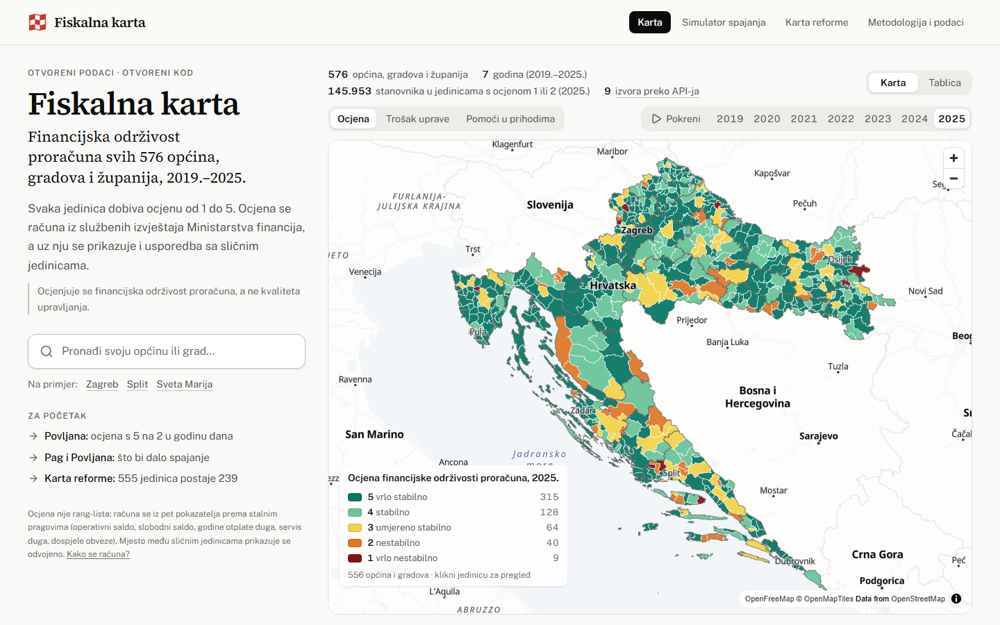
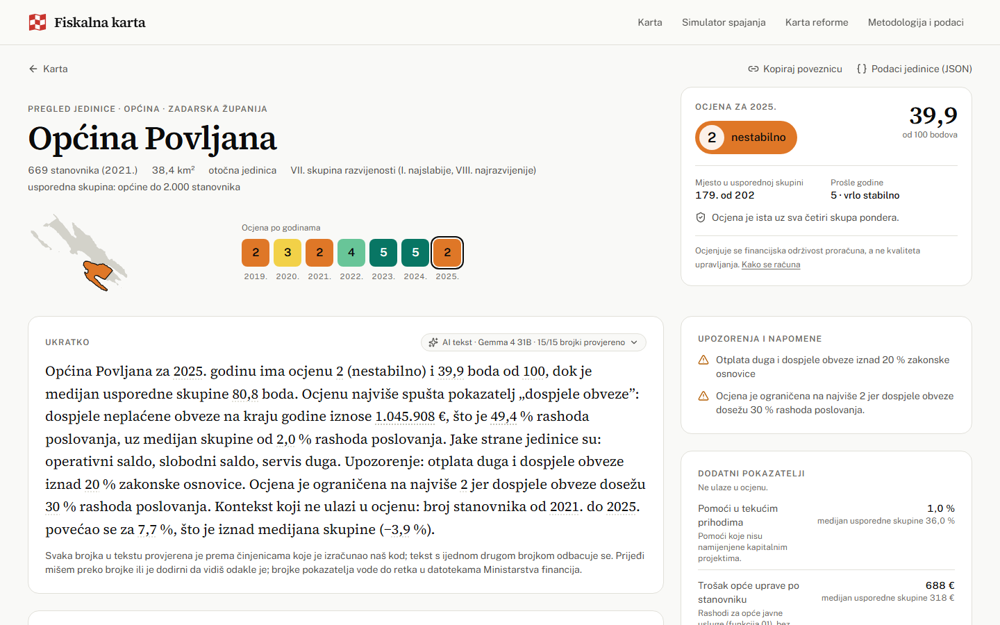
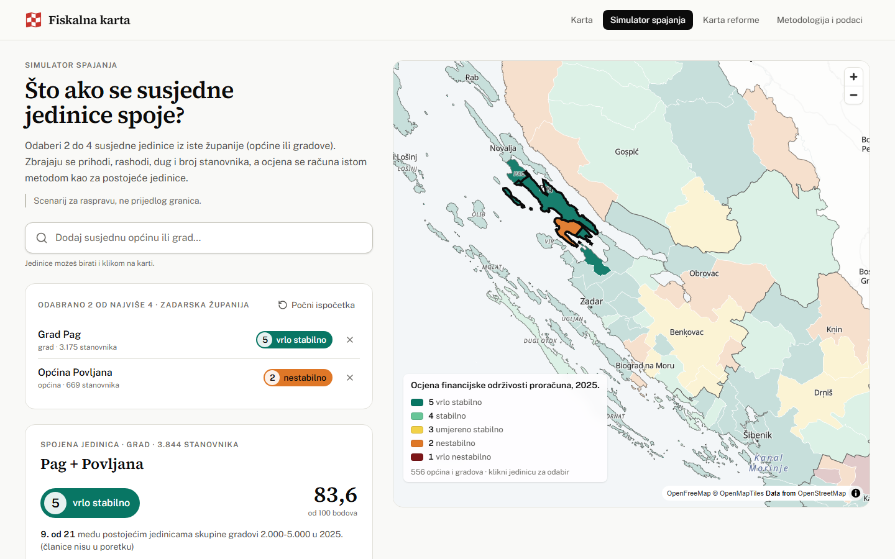
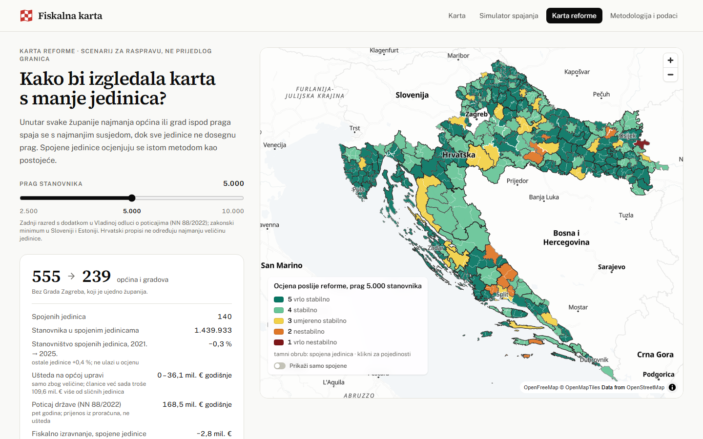
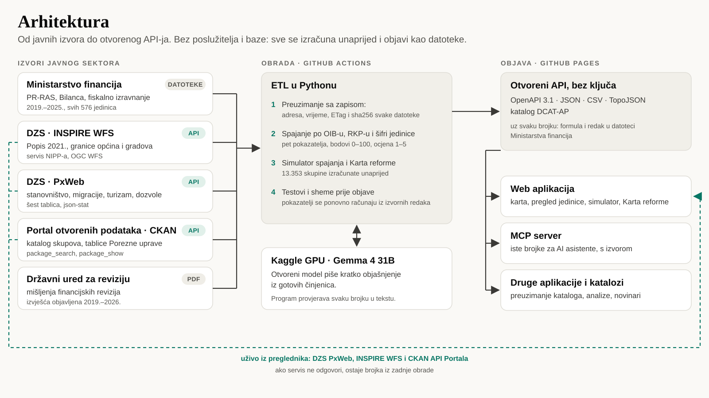

# Fiskalna karta: tehnička i projektna dokumentacija

**Datathon Portala otvorenih podataka 2026 · izazov C: Gospodarstvo i učinkovito upravljanje**

Tim: Begovi mušketiri · članovi: [ime i prezime, …] · mentor: doc. dr. sc. Stjepan Begušić (FER)

| | |
|---|---|
| Radni prototip | <https://abi-azan.github.io/Datathon-Portala-otvorenih-podataka-2026/> |
| Izvorni kod (EUPL-1.2) | <https://github.com/abi-azan/Datathon-Portala-otvorenih-podataka-2026> |
| Video prezentacija | [poveznica] |
| Otvoreni API | `…/api/v1/openapi.json` (OpenAPI 3.1), katalog `…/api/v1/dcat.jsonld` (DCAT-AP) |

## 1. Sažetak

Hrvatska ima 576 općina, gradova i županija. Svaka jednom godišnje predaje financijske izvještaje, a Ministarstvo financija objavljuje ih kao Excel tablice s tisućama redaka. Je li neka općina financijski stabilna, iz tih tablica može pročitati samo stručnjak, i to za jednu po jednu jedinicu.

Fiskalna karta iz tih izvještaja računa ocjenu financijske održivosti proračuna od 1 do 5 za svaku jedinicu i svaku godinu od 2019. do 2025. Uz ocjenu pokazuje usporedbu sa sličnim jedinicama, kratko objašnjenje običnim riječima i put od svake brojke do retka u izvornoj datoteci. Simulator pokazuje što bi dalo spajanje susjednih jedinica, a Karta reforme isti izračun za cijelu državu.

Ocjenjuje se financijska održivost proračuna, a ne kvaliteta upravljanja.

## 2. Gdje se vidi koji kriterij

| Kriterij | Gdje se vidi | Odjeljak |
|---|---|---|
| Upotreba otvorenih podataka | Svaki izvor koji ima upotrebljiv API čita se preko API-ja (CKAN, PxWeb, WFS), i u obradi i uživo iz preglednika. Stranica „Metodologija i podaci”, ploča „Podaci preko API-ja”. | 4 |
| Povezivanje javno dostupnih podataka | Podaci sedam tijela javnog sektora spojeni po OIB-u, RKP-u i službenoj šifri jedinice. | 4, 5 |
| Relevantnost rješenja | Fiskalna održivost svih jedinica, simulator spajanja i Karta reforme. | 3 |
| Utjecaj i korist za zajednicu | Građani, vijećnici, novinari, ministarstva; primjeri uporabe. | 9 |
| Inovativnost i primjena tehnologija | Otvoreni jezični model piše objašnjenje, a program provjerava svaku brojku; MCP server za AI asistente. | 6 |
| Izvedivost rješenja | Radni prototip za svih 576 jedinica, testovi i automatska objava. | 8 |
| Tehnička arhitektura i integracijski potencijal | Statični otvoreni API, OpenAPI 3.1, DCAT-AP, stabilni ključevi, preduvjeti. | 7 |
| Dojam rješenja | Naslovnica s kartom, pregled jedinice, simulator, Karta reforme. | 3 |
| Prezentacija rješenja | Video do 3 minute. | – |

## 3. Što rješenje radi

- **Karta** svih 556 općina i gradova obojenih prema ocjeni, za svaku godinu od 2019. do 2025. Gumb „Pokreni” prikazuje godine redom. Pretraga radi i bez dijakritičkih znakova, a tablica je alternativa karti.
- **Pregled jedinice.** Ocjena i bodovi od 0 do 100, pet pokazatelja uz medijan sličnih jedinica, kretanje kroz sedam godina i upozorenja. Primjer: Općina Povljana na Pagu ima ocjenu 2, a godinu prije imala je 5. Spuštaju je dospjele neplaćene obveze od 1.045.908 €, što je 49,4 % rashoda poslovanja.
- **Prikaži izračun.** Uz svaki pokazatelj stoje formula i ulazni iznosi s kontom, listom i retkom u datoteci Ministarstva financija.
- **Simulator spajanja.** Korisnik odabere dvije do četiri susjedne jedinice iste županije i vidi ocjenu spojene jedinice, raspon uštede na općoj upravi i promjenu fiskalnog izravnanja. Svih 13.353 dopuštenih skupina izračunato je unaprijed.
- **Karta reforme.** Unutar županije najmanja jedinica ispod praga spaja se s najmanjim susjedom. Za prag od 5.000 stanovnika od 555 općina i gradova ostaje 239. To je scenarij za raspravu, a ne prijedlog granica.
- **Kontekst koji ne ulazi u ocjenu:** kretanje stanovništva, dohodak, turizam, građevinske dozvole, fiskalno izravnanje, zadnje mišljenje Državnog ureda za reviziju i podaci koje jedinica sama objavljuje na Portalu.

## 4. Podaci

Svi korišteni skupovi podataka s izdavateljem, poveznicom, licencom i načinom pristupa navedeni su u prilogu. Isti popis je u repozitoriju (`docs/skupovi-podataka.md`) i u API-ju (`api/v1/skupovi.json`).

| Izdavatelj | Što koristimo | Pristup |
|---|---|---|
| Ministarstvo financija | financijski izvještaji jedinica (PR-RAS, RAS-funkcijski, Bilanca) 2019.–2025.; tablice i odluke o fiskalnom izravnanju | datoteke (Excel, PDF) |
| Državni zavod za statistiku | Popis 2021. i granice općina i gradova (INSPIRE) | **API: OGC WFS** |
| Državni zavod za statistiku | procjena stanovništva, migracije, rođeni i umrli, turizam, građevinske dozvole | **API: PxWeb** |
| Portal otvorenih podataka (MPUDT) | katalog svih skupova; koje jedinice objavljuju podatke i kada | **API: CKAN** |
| Porezna uprava | neto dohodak stanovništva, porezne stope jedinica | datoteke na Portalu, pronađene preko CKAN API-ja |
| Državni ured za reviziju | mišljenja financijskih revizija jedinica | PDF |
| Državna geodetska uprava; Ministarstvo regionalnoga razvoja i fondova EU | šifrarnik jedinica; indeks razvijenosti | datoteke, preuzete jednom |

**API ili datoteka.** Svaki izvor koji ima upotrebljiv API čitamo preko njega: devet skupova kroz tri servisa. Ta tri servisa stranica pita i uživo iz preglednika. Na pregledu jedinice broj stanovnika stiže s API-ja DZS-a, a broj skupova koje jedinica objavljuje s API-ja Portala. Ako servis ne odgovori, ostaje brojka iz zadnje obrade.

Datoteke ostaju samo tamo gdje API ne postoji. Ministarstvo financija i Državni ured za reviziju objavljuju samo Excel i PDF. Jedina tablica Porezne uprave koja na Portalu ima DataStore API u njemu ima 10.198 praznih redaka od 10.754, pa i nju čitamo iz datoteke. Nijedna datoteka ne preuzima se ručno. Obrada ih preuzima sama i za svaku bilježi adresu, vrijeme, ETag i sha256 (`api/v1/izvori.json`).

**Licence.** Podaci s Portala koriste se pod Otvorenom dozvolom, uz navođenje izvora. Ministarstvo financija ne navodi licencu, pa njegove podatke koristimo prema Zakonu o pravu na pristup informacijama i uz uvjete Otvorene dozvole (Pravilnik NN 67/17, čl. 4.). Izjava o izvoru je u podnožju svake stranice.

## 5. Kako su podaci povezani

Svaka jedinica ima tri stabilna ključa: OIB, broj RKP iz registra proračunskih korisnika i službenu peteroznamenkastu šifru DZS-a i DGU-a. Izvještaji Ministarstva financija spajaju se po nazivu i županiji, a zatim se preko OIB-a povezuju sa šifrom. Po šifri se dodaju granice, popis stanovništva i tablice DZS-a. Izdavatelji na Portalu povezuju se s jedinicama po nazivu.

Iz tog spoja nastaje ono čega nema ni u jednom izvoru:

- ocjena svake jedinice i njezino mjesto među sličnima po vrsti i veličini;
- iznosi po stanovniku;
- susjedstvo jedinica iz granica, na kojem rade simulator i Karta reforme;
- fiskalno izravnanje spojene jedinice, izračunato po zakonskoj formuli (izračun daje iste iznose kao Ministarstvo financija za svih 576 jedinica);
- pregled koje jedinice objavljuju podatke na Portalu: 269 od 576.

## 6. Metodologija i umjetna inteligencija

**Ocjena.** Pet pokazatelja boduje se od 0 do 100 prema stalnim pragovima iz prakse KDZ-a (Austrija) i INEKO-a (Slovačka): operativni saldo (ponder 20), slobodni saldo (20), godine otplate duga (15), servis duga (15) i dospjele obveze (30). Ponderirani zbroj daje ocjenu od 1 (vrlo nestabilno) do 5 (vrlo stabilno). Pragovi, ponderi i pravila čitaju se iz koda i prikazuju na stranici „Metodologija i podaci”.

**Objašnjenje.** Kratki tekst na pregledu jedinice piše otvoreni jezični model Gemma 4 31B (Apache-2.0) na besplatnom Kaggle GPU-u. Model ne računa i ne bira što je važno:

1. naš kod izračuna sve brojke i složi popis činjenica za jedinicu;
2. model od tih činjenica napiše tri do pet rečenica;
3. program provjeri tekst: svaka brojka mora postojati u činjenicama, ocjena, najslabiji pokazatelj i jake strane moraju se slagati s njima, a uz brojku mora ostati riječ koja joj daje smisao (Gradu Kninu „nedostaje” 18,4 % tekućih prihoda, a medijanu skupine „ostaje” 9,2 %);
4. tekst koji ne prođe vraća se modelu s popisom grešaka, najviše dva puta, a zatim se koristi predložak.

Na stranici uz tekst piše koliko je brojki provjereno, a svaka brojka pokazuje činjenicu iz koje dolazi. Tekstovi su spremljeni u repozitoriju zajedno s otiskom činjenica iz kojih su nastali, pa se pri objavi model ne poziva.

**MCP server.** Iste brojke dostupne su AI asistentima preko MCP servera (`fiskalna_mcp`), sa šest alata: pronalaženje jedinice, pregled, usporedba, scenarij spajanja, Karta reforme i izvor brojke. Asistent tako odgovara našim brojkama, uz poveznicu na izvor.

## 7. Tehnička arhitektura

Rješenje nema poslužitelj ni bazu. Obrada u Pythonu (`pipeline/`) pokreće se u GitHub Actionsu: preuzme izvore, izračuna pokazatelje, pokrene testove i objavi rezultat kao statične datoteke na GitHub Pagesu. Web aplikacija (`web/`: React, MapLibre) i MCP server čitaju iste datoteke kao i svaki drugi korisnik API-ja.

**Interoperabilni standardi:** OpenAPI 3.1 i JSON Schema za opis API-ja, DCAT-AP za katalog skupova, INSPIRE i OGC WFS za prostorne podatke, json-stat za statistiku, TopoJSON za granice, CSV i JSON za rezultate, MCP za AI asistente.

**Povezivanje s postojećim javnim sustavima:**

| Sustav | Ključ ili standard | Kako se spaja |
|---|---|---|
| Portal otvorenih podataka (CKAN) | DCAT-AP, CKAN API | Naš katalog `dcat.jsonld` može preuzeti svaki katalog koji podržava DCAT-AP, bez ručnog unosa. |
| Registar proračunskih korisnika (Ministarstvo financija) | RKP | Rezultati se spajaju s bilo kojom tablicom Ministarstva financija ili FINA-e. |
| Sustavi koji jedinicu vode po OIB-u | OIB | OIB je u šifrarniku i u svakoj datoteci jedinice. |
| DZS, DGU, Nacionalna infrastruktura prostornih podataka | službena šifra, INSPIRE | Statistika i granice spajaju se po šifri. |
| Druge aplikacije i analitički alati | OpenAPI 3.1, JSON, CSV | Sve što stranica prikazuje dostupno je kao datoteka, bez ključa. |

**Preduvjeti:**

- **Tehnički:** GitHub (repozitorij, Actions, Pages), Python 3.12 i Node.js 22 u obradi; besplatni Kaggle GPU oko četiri sata godišnje. Stranica radi u svakom suvremenom pregledniku. Ako preglednik ne podržava WebGL, karta se prikazuje u jednostavnijem obliku.
- **Organizacijski:** Ministarstvo financija izvještaje objavljuje jednom godišnje, a obrada ih preuzima sama. Održavanje traži jednu osobu koja godišnje pregleda nove podatke i ponovno pokrene pisanje objašnjenja.
- **Pravni:** podaci Ministarstva financija koriste se prema Zakonu o pravu na pristup informacijama; kod je pod licencom EUPL-1.2, a podaci koje rješenje proizvodi pod CC BY 4.0. Rješenje ne obrađuje osobne podatke.

Najviše bi pomoglo da Ministarstvo financija ove izvještaje objavljuje na Portalu, s licencom i API-jem. Tada bi se cijela karta punila s Portala.

## 8. Izvedivost i provjere

- Prototip radi za svih 576 jedinica i sedam godina i javno je dostupan.
- Svaka izmjena u glavnoj grani pokreće cijelu obradu, testove i objavu.
- 283 automatska testa. Jedan od njih iz objavljenih ulaznih redaka ponovno računa svih pet pokazatelja za svih 576 jedinica. Drugi svaku objavljenu datoteku provjerava prema shemi iz `openapi.json`.
- Zbroj prihoda i rashoda svih jedinica slaže se s državnim zbrojem Ministarstva financija do 1 € za svaku godinu.
- Prije predaje svaka od 576 stranica jedinica otvorena je u pregledniku, kao i po dvije skupine simulatora za svaku županiju i sva tri praga Karte reforme, bez ijedne greške.
- Pristupačnost: provjera alatom axe (WCAG 2, razine A i AA) ne nalazi prekršaje na pet glavnih stranica.
- Ako vanjski servis ne odgovori, stranica prikazuje podatak iz zadnje obrade. Ako se podloga karte ne učita, karta radi bez nje.

## 9. Korist i korisnici

| Tko | Što dobiva |
|---|---|
| Građanin | U minuti vidi ocjenu svoje općine ili grada, što je spušta i kako stoje slične jedinice. |
| Vijećnik, načelnik, pročelnik za financije | Usporedbu sa sličnim jedinicama prije rasprave o proračunu; upozorenja koja se inače vide tek u reviziji. |
| Novinar | Provjerljivu priču: svaka brojka vodi do retka u datoteci Ministarstva financija. |
| Ministarstvo financija i tijela nadležna za lokalnu samoupravu | Brojke za raspravu o spajanju jedinica. Za prag od 5.000 stanovnika ušteda na općoj upravi je do 36,1 mil. € godišnje, a državni poticaj za spajanje 168,5 mil. €. |
| MPUDT i Portal otvorenih podataka | Pregled koje jedinice objavljuju podatke na Portalu (269 od 576) i primjer ponovne uporabe s navođenjem izvora do razine retka. |

U jedinicama s ocjenom 1 ili 2 živi 145.953 stanovnika (2025.).

## 10. Daljnji razvoj

- **Podaci Ministarstva financija na Portalu.** Tada se cijela karta puni preko CKAN API-ja.
- **Godišnje osvježavanje.** Kad Ministarstvo financija objavi 2026., ista obrada izračuna novu ocjenu. Objašnjenja se ponovno pišu samo za jedinice čije su se činjenice promijenile.
- **Proračunski korisnici.** Sada se ocjenjuje proračun same jedinice, bez vrtića i ustanova. Konsolidirana slika bila bi potpunija.
- **Plan i izvršenje.** Proračuni koje jedinice objavljuju na Portalu, uz izvršenje iz izvještaja Ministarstva financija.
- Prognozu razvoja jedinica testirali smo i odbacili: model s 36 prediktora ne predviđa rast dohotka bolje od prošlog trenda (`docs/research/13-prediktori-razvoja.md`).

## 11. Licence i korišteni alati

- **Kod:** EUPL-1.2. **Podaci koje rješenje proizvodi:** CC BY 4.0, uz navođenje izvornih skupova.
- **Softver:** sve knjižnice su otvorenog koda; popis s licencama je u `THIRD_PARTY_LICENSES.md`.
- **AI u proizvodu:** Gemma 4 31B (Apache-2.0), pokrenuta programom llama.cpp (MIT) na Kaggle GPU-u. U aplikaciji se prikazuju samo tekstovi tog otvorenog modela.
- **AI u razvoju:** Claude Code (vlasnički alat) za pisanje i pregled koda, testove, provjeru brojki i nacrte dokumentacije, prema planu i odlukama tima (`docs/PLAN.md` §11). Radni dnevnici su u `docs/dnevnik/`.
